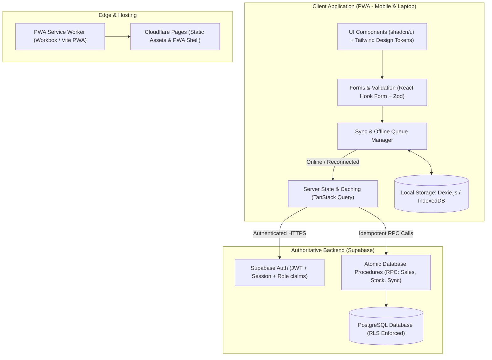
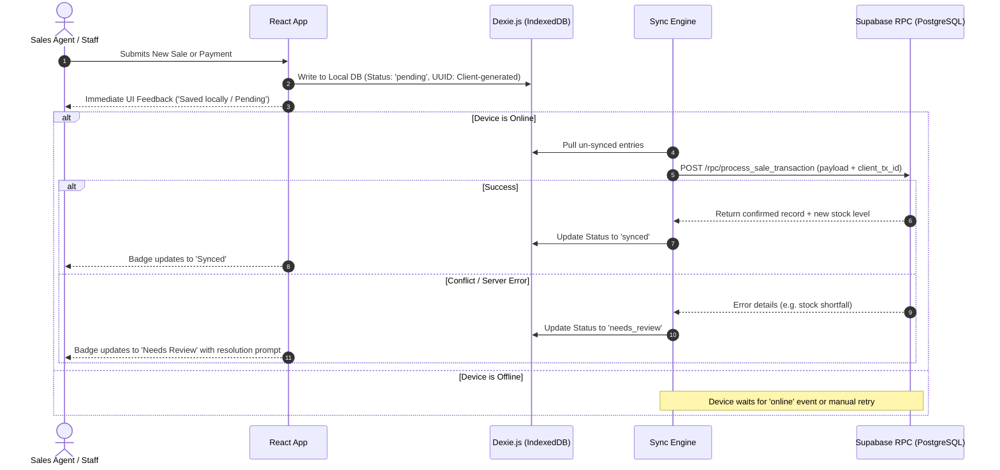

# BMS Technical Architecture & System Design

**Project:** Bakery Management System (BMS)  
**Document:** System Architecture & Implementation Blueprint  
**Standard:** Oyebode Solution Builder Architecture Standard  

---

## 1. High-Level System Architecture



---

## 2. Centralised Design System & Branding Architecture

To guarantee effortless client visual revisions (colors, typography, spacing, branding) without code rewrites, BMS implements a 3-tier design token model:

### A. Business Branding Configuration (`src/config/branding.config.ts`)
```typescript
export interface BakeryBrandingConfig {
  businessName: string;
  tagline: string;
  phone: string;
  email: string;
  address: string;
  currency: {
    symbol: string;
    code: string;
    locale: string;
  };
  receipt: {
    headerNote: string;
    footerNote: string;
    logoUrl?: string;
  };
}

export const defaultBranding: BakeryBrandingConfig = {
  businessName: "Artisan Bakery & Confectionery",
  tagline: "Freshly Baked Daily",
  phone: "+234 800 000 0000",
  email: "orders@bakery.local",
  address: "Plot 12, Commercial Avenue, Lagos, Nigeria",
  currency: {
    symbol: "₦",
    code: "NGN",
    locale: "en-NG",
  },
  receipt: {
    headerNote: "Welcome to Our Bakery",
    footerNote: "Thank you for your patronage! Please verify your items.",
  },
};
```

### B. CSS Variables & Semantic Tokens (`src/index.css`)
All styling is bound to CSS variables mapping directly to Tailwind utility classes:
- `--primary`: Restrained warm bakery accent (e.g. warm terracotta/golden wheat: `hsl(28, 75%, 45%)`).
- `--primary-foreground`: High contrast text (`hsl(0, 0%, 100%)`).
- `--background`: Warm off-white (`hsl(30, 20%, 98%)`).
- `--surface`: Pure white card backgrounds (`hsl(0, 0%, 100%)`).
- `--foreground`: Deep dark charcoal (`hsl(220, 20%, 14%)`).
- `--muted` / `--muted-foreground`: Soft warm gray / subtle text.
- `--border`: Crisp light divider (`hsl(30, 15%, 88%)`).
- `--success`: Forest green balance confirmation (`hsl(142, 65%, 38%)`).
- `--destructive`: Amber-red debt/loss warning (`hsl(0, 72%, 51%)`).
- `--radius`: Global border radius (`0.5rem`).

*Client revision rule:* Changing the primary brand tone requires updating exactly one CSS variable or branding config value.

---

## 3. Offline-First Synchronization & Data Integrity

The offline synchronization engine prevents duplicate submissions, resolves intermittent connectivity drops, and protects inventory integrity.

### Sync Pipeline Workflow



### Key Offline Invariants:
1. **Client-Generated UUIDs:** Every transaction (sale, payment, production log, stock adjustment) originates with a deterministic v4 UUID generated on the client.
2. **Idempotent RPC Execution:** If an offline queue submits the same transaction multiple times due to patchy network reconnects, Supabase handles it idempotently based on `client_tx_id`.
3. **Atomic Stock Decrements:** Server-side functions execute in an atomic transaction:
   - Insert sale header
   - Insert sale line items
   - Insert initial payment record
   - Decrement finished product inventory
4. **Honest UI Indicators:**
   - `Saved locally`: In browser storage, waiting for sync dispatch.
   - `Syncing`: Request currently in flight.
   - `Synced`: Verified by Supabase PostgreSQL.
   - `Needs review`: Discrepancy flagged (e.g., disconnected agent sold stock that ran out concurrently).

---

## 4. Proposed Project Folder Structure

```text
bms/
├── .agents/
├── docs/
│   ├── bms-playbook.pdf
│   ├── mvp-spec.md
│   ├── architecture.md
│   └── data-model.md
├── public/
│   ├── favicon.ico
│   ├── manifest.json
│   ├── icons/
│   └── offline.html
├── src/
│   ├── assets/
│   ├── components/
│   │   ├── common/               # Reusable atomic UI (Button, Input, Card, Table, Badge, Modal)
│   │   ├── feedback/             # SyncStatusBadge, ErrorBoundary, EmptyState, LoadingSkeleton
│   │   ├── layout/               # AppShell, DesktopSidebar, MobileBottomNav, Header, RoleGate
│   │   ├── printing/             # PrintableReceipt, ThermalReceipt58, ThermalReceipt80
│   │   └── ui/                   # shadcn/ui primitives
│   ├── config/
│   │   ├── branding.config.ts    # Centralized client branding (Name, Logo, Receipt notes)
│   │   ├── navigation.config.ts  # Role-specific navigation definitions
│   │   └── routes.config.ts      # Canonical application route constants
│   ├── context/
│   │   ├── AuthContext.tsx       # Auth session & current active role
│   │   └── SyncContext.tsx       # Online status & queue watcher
│   ├── db/
│   │   ├── localDb.ts            # Dexie.js IndexedDB schema and stores
│   │   ├── supabase.ts           # Supabase client instance
│   │   └── syncEngine.ts         # Synchronization runner & retry logic
│   ├── hooks/
│   │   ├── useNetworkStatus.ts   # Online/offline detector
│   │   ├── useSales.ts           # React Query hooks for sales
│   │   ├── useInventory.ts       # React Query hooks for stock
│   │   ├── useSyncQueue.ts       # Queue status inspection
│   │   └── useThermalPrint.ts    # Print layout handlers
│   ├── lib/
│   │   ├── excel.ts              # ExcelJS export/import parser & validator
│   │   ├── formatters.ts         # Currency (NGN), date, numbers
│   │   └── utils.ts              # Classnames merger (clsx + twMerge)
│   ├── pages/
│   │   ├── auth/                 # Login & Password recovery
│   │   ├── dashboard/            # Owner operational KPIs & summaries
│   │   ├── sales/                # Sales register, New Sale POS, Partial payment form
│   │   ├── customers/            # Customer directory & Debt balances ledger
│   │   ├── production/           # Production batch logging & wastage
│   │   ├── raw-materials/        # Ingredient stocks, receipts, usage
│   │   ├── distribution/         # Distributor allocations, deliveries, returns
│   │   ├── reports/              # Excel export, audit logs, reconciliation
│   │   └── settings/             # Staff management, product catalog, branding
│   ├── routes/
│   │   └── AppRouter.tsx         # Route configuration with role protection
│   ├── types/
│   │   ├── database.types.ts     # Supabase auto-generated/typed schema
│   │   ├── domain.types.ts       # Domain models (Sale, Customer, Product, etc.)
│   │   └── sync.types.ts         # Queue entry definitions
│   ├── App.tsx
│   ├── main.tsx
│   └── index.css                 # Master CSS variables & Tailwind directives
├── index.html
├── package.json
├── tailwind.config.ts
├── tsconfig.json
└── vite.config.ts
```

---

## 5. Application Route Map

| Path | Primary Persona | Purpose |
| :--- | :--- | :--- |
| `/login` | All | Role-based authentication entry |
| `/dashboard` | Owner | Operational snapshot: sales, cash, debt, stock, alerts |
| `/sales` | Owner, Salesperson | Active sales register, search & filter |
| `/sales/new` | Owner, Salesperson | Rapid sale creation (mobile-first touch POS) |
| `/sales/:id/receipt` | Owner, Salesperson | View, print 58/80mm or export thermal receipt |
| `/customers` | Owner, Salesperson | Directory, running debt balances, payment history |
| `/customers/:id/repay` | Owner, Salesperson | Record installment payment against existing debt |
| `/production` | Owner, Assigned Staff | Record baked items, damages, usable stock increments |
| `/raw-materials` | Owner, Assigned Staff | Record ingredient receipts, usage, waste, balances |
| `/distribution` | Owner, Distributor | Allocation dispatch, distributor delivery confirmation, returns |
| `/reports` | Owner | Periodic summaries, audit trails, Excel downloads/uploads |
| `/settings/products` | Owner | Product catalog, pricing, category config |
| `/settings/staff` | Owner | Staff role assignments and access management |
| `/sync-status` | All | Diagnostic view for pending offline operations |

---

## 6. Implementation Milestones

Following the Oyebode Solution Builder vertical-slice delivery methodology:

### Milestone 1: Design Tokens, Branding & Reviewable UI Prototype
- Initialize React + Vite + TypeScript + Tailwind + shadcn/ui.
- Setup centralized `branding.config.ts` and semantic CSS token system.
- Build role-specific responsive layouts (Desktop sidebar + Mobile bottom nav).
- Build clickable, realistic prototype screens (Dashboard, New Sale touch form, Partial payment flow, 58/80mm Receipt preview, Inventory table) with mock data for client presentation and review.

### Milestone 2: Authoritative Database, Auth & RBAC
- Setup Supabase project, execute PostgreSQL migration with RLS.
- Implement Supabase Auth with custom role claims (`owner`, `salesperson`, `distributor`).
- Wire authentication context and route guards (`RoleGate`).
- Implement Product & Customer management with live DB queries.

### Milestone 3: Core Transactional Workflows
- Implement atomic Sales & Partial Payment creation with single-decrement stock logic.
- Implement Debt Repayment against original sale IDs.
- Implement Production Batch logging (produced, damaged, net usable stock).
- Implement Raw Material movements (receipts, usage, waste).
- Implement Distributor Allocation, delivery confirmation, returns, and reconciliation.

### Milestone 4: Offline PWA & Dexie.js Sync Engine
- Configure Vite PWA Service Worker for app shell caching.
- Implement Dexie.js local stores for pending transactions.
- Build Sync Engine with automatic network reconnection listener and visual status badges (`Saved locally`, `Pending`, `Synced`, `Needs review`).
- Implement idempotent backend RPCs with conflict detection for concurrent sales.

### Milestone 5: Outputs, Excel & Thermal Printing
- Build 58mm / 80mm printable receipt templates and browser print stylesheet.
- Implement ExcelJS workbook generator for operational exports.
- Implement Excel template importer with preview error validation for initial products and opening stock.

### Milestone 6: Multi-Device Verification, Hardening & Deployment
- Verification on actual Android and iOS mobile devices + desktop viewport.
- Offline disconnect/reconnect tests.
- Deploy to Cloudflare Pages with custom domain, HTTPS, and PWA manifest.
- Deliver concise user guide and backup procedure documentation.

