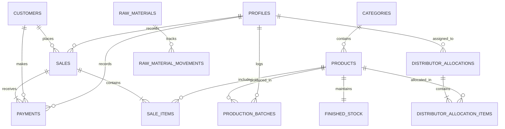

# BMS Lean Relational Data Model

**Project:** Bakery Management System (BMS)  
**Database:** PostgreSQL (via Supabase) + IndexedDB (via Dexie.js for offline operations)  
**Security Model:** Row-Level Security (RLS) + Foreign Key Constraints + Atomic RPCs  

---

## 1. Entity-Relationship Overview



---

## 2. PostgreSQL Tables & DDL Specification

### A. Core Profiles & Security
```sql
-- Profiles table linked to Supabase auth.users
CREATE TYPE user_role AS ENUM ('owner', 'salesperson', 'distributor');

CREATE TABLE profiles (
    id UUID PRIMARY KEY REFERENCES auth.users(id) ON DELETE CASCADE,
    full_name TEXT NOT NULL,
    phone TEXT,
    role user_role NOT NULL DEFAULT 'salesperson',
    is_active BOOLEAN NOT NULL DEFAULT TRUE,
    created_at TIMESTAMPTZ NOT NULL DEFAULT timezone('utc', now()),
    updated_at TIMESTAMPTZ NOT NULL DEFAULT timezone('utc', now())
);
```

### B. Catalog & Finished Stock
```sql
CREATE TABLE categories (
    id UUID PRIMARY KEY DEFAULT gen_random_uuid(),
    name TEXT NOT NULL UNIQUE,
    display_order INT DEFAULT 0,
    created_at TIMESTAMPTZ NOT NULL DEFAULT timezone('utc', now())
);

CREATE TABLE products (
    id UUID PRIMARY KEY DEFAULT gen_random_uuid(),
    category_id UUID REFERENCES categories(id) ON DELETE SET NULL,
    name TEXT NOT NULL,
    unit_price NUMERIC(12, 2) NOT NULL CHECK (unit_price >= 0),
    min_stock_alert INT NOT NULL DEFAULT 10,
    is_active BOOLEAN NOT NULL DEFAULT TRUE,
    created_at TIMESTAMPTZ NOT NULL DEFAULT timezone('utc', now()),
    updated_at TIMESTAMPTZ NOT NULL DEFAULT timezone('utc', now())
);

CREATE TABLE finished_stock (
    product_id UUID PRIMARY KEY REFERENCES products(id) ON DELETE CASCADE,
    current_stock INT NOT NULL DEFAULT 0,
    last_counted_at TIMESTAMPTZ NOT NULL DEFAULT timezone('utc', now()),
    updated_at TIMESTAMPTZ NOT NULL DEFAULT timezone('utc', now())
);
```

### C. Customers & Debt Tracking
```sql
CREATE TABLE customers (
    id UUID PRIMARY KEY DEFAULT gen_random_uuid(),
    name TEXT NOT NULL,
    phone TEXT,
    email TEXT,
    notes TEXT,
    current_debt NUMERIC(12, 2) NOT NULL DEFAULT 0.00,
    is_active BOOLEAN NOT NULL DEFAULT TRUE,
    created_at TIMESTAMPTZ NOT NULL DEFAULT timezone('utc', now()),
    updated_at TIMESTAMPTZ NOT NULL DEFAULT timezone('utc', now())
);

-- Reserved record for walk-in counter sales
INSERT INTO customers (id, name, phone, notes)
VALUES ('00000000-0000-0000-0000-000000000001', 'Walk-in Customer', NULL, 'Default counter customer');
```

### D. Sales & Payments (Append-Only Payment History)
```sql
CREATE TYPE payment_status AS ENUM ('paid', 'partial', 'credit');
CREATE TYPE payment_method AS ENUM ('cash', 'transfer', 'pos');

CREATE TABLE sales (
    id UUID PRIMARY KEY DEFAULT gen_random_uuid(),
    client_tx_id UUID UNIQUE NOT NULL, -- Deterministic client-generated UUID for idempotent sync
    receipt_number TEXT UNIQUE NOT NULL,
    customer_id UUID NOT NULL REFERENCES customers(id),
    total_amount NUMERIC(12, 2) NOT NULL CHECK (total_amount >= 0),
    paid_amount NUMERIC(12, 2) NOT NULL DEFAULT 0.00 CHECK (paid_amount >= 0),
    balance_amount NUMERIC(12, 2) NOT NULL CHECK (balance_amount >= 0),
    payment_status payment_status NOT NULL,
    recorded_by UUID NOT NULL REFERENCES profiles(id),
    notes TEXT,
    created_at TIMESTAMPTZ NOT NULL DEFAULT timezone('utc', now()),
    updated_at TIMESTAMPTZ NOT NULL DEFAULT timezone('utc', now())
);

CREATE TABLE sale_items (
    id UUID PRIMARY KEY DEFAULT gen_random_uuid(),
    sale_id UUID NOT NULL REFERENCES sales(id) ON DELETE CASCADE,
    product_id UUID NOT NULL REFERENCES products(id),
    quantity INT NOT NULL CHECK (quantity > 0),
    unit_price NUMERIC(12, 2) NOT NULL CHECK (unit_price >= 0),
    subtotal NUMERIC(12, 2) NOT NULL CHECK (subtotal >= 0)
);

CREATE TABLE payments (
    id UUID PRIMARY KEY DEFAULT gen_random_uuid(),
    client_tx_id UUID UNIQUE NOT NULL,
    sale_id UUID NOT NULL REFERENCES sales(id) ON DELETE RESTRICT,
    customer_id UUID NOT NULL REFERENCES customers(id) ON DELETE RESTRICT,
    amount NUMERIC(12, 2) NOT NULL CHECK (amount > 0),
    method payment_method NOT NULL,
    reference_note TEXT,
    recorded_by UUID NOT NULL REFERENCES profiles(id),
    recorded_at TIMESTAMPTZ NOT NULL DEFAULT timezone('utc', now())
);
```

### E. Production & Raw Materials (Manual Usages)
```sql
CREATE TABLE production_batches (
    id UUID PRIMARY KEY DEFAULT gen_random_uuid(),
    client_tx_id UUID UNIQUE NOT NULL,
    product_id UUID NOT NULL REFERENCES products(id),
    quantity_produced INT NOT NULL CHECK (quantity_produced >= 0),
    quantity_damaged INT NOT NULL DEFAULT 0 CHECK (quantity_damaged >= 0),
    net_usable INT GENERATED ALWAYS AS (quantity_produced - quantity_damaged) STORED,
    batch_date DATE NOT NULL DEFAULT CURRENT_DATE,
    recorded_by UUID NOT NULL REFERENCES profiles(id),
    notes TEXT,
    created_at TIMESTAMPTZ NOT NULL DEFAULT timezone('utc', now())
);

CREATE TABLE raw_materials (
    id UUID PRIMARY KEY DEFAULT gen_random_uuid(),
    name TEXT NOT NULL UNIQUE,
    unit_of_measure TEXT NOT NULL, -- 'kg', '50kg bag', 'litre', 'carton'
    current_stock NUMERIC(12, 2) NOT NULL DEFAULT 0.00,
    min_stock_alert NUMERIC(12, 2) NOT NULL DEFAULT 5.00,
    created_at TIMESTAMPTZ NOT NULL DEFAULT timezone('utc', now()),
    updated_at TIMESTAMPTZ NOT NULL DEFAULT timezone('utc', now())
);

CREATE TYPE raw_material_movement_type AS ENUM ('receipt', 'usage', 'waste');

CREATE TABLE raw_material_movements (
    id UUID PRIMARY KEY DEFAULT gen_random_uuid(),
    client_tx_id UUID UNIQUE NOT NULL,
    raw_material_id UUID NOT NULL REFERENCES raw_materials(id),
    movement_type raw_material_movement_type NOT NULL,
    quantity NUMERIC(12, 2) NOT NULL CHECK (quantity > 0),
    unit_cost NUMERIC(12, 2), -- Optional tracking of purchase cost
    notes TEXT,
    recorded_by UUID NOT NULL REFERENCES profiles(id),
    recorded_at TIMESTAMPTZ NOT NULL DEFAULT timezone('utc', now())
);
```

### F. Distribution Management
```sql
CREATE TYPE allocation_status AS ENUM ('assigned', 'acknowledged', 'reconciled');

CREATE TABLE distributor_allocations (
    id UUID PRIMARY KEY DEFAULT gen_random_uuid(),
    client_tx_id UUID UNIQUE NOT NULL,
    distributor_id UUID NOT NULL REFERENCES profiles(id),
    allocation_date DATE NOT NULL DEFAULT CURRENT_DATE,
    status allocation_status NOT NULL DEFAULT 'assigned',
    assigned_by UUID NOT NULL REFERENCES profiles(id),
    reconciled_at TIMESTAMPTZ,
    notes TEXT,
    created_at TIMESTAMPTZ NOT NULL DEFAULT timezone('utc', now())
);

CREATE TABLE distributor_allocation_items (
    id UUID PRIMARY KEY DEFAULT gen_random_uuid(),
    allocation_id UUID NOT NULL REFERENCES distributor_allocations(id) ON DELETE CASCADE,
    product_id UUID NOT NULL REFERENCES products(id),
    quantity_allocated INT NOT NULL CHECK (quantity_allocated > 0),
    quantity_sold INT NOT NULL DEFAULT 0 CHECK (quantity_sold >= 0),
    quantity_returned INT NOT NULL DEFAULT 0 CHECK (quantity_returned >= 0),
    notes TEXT
);
```

---

## 3. Dexie.js (IndexedDB) Local Stores for Offline Operations

On the client, Dexie stores mirrored cached entities plus the persistent outbound sync queue:

```typescript
// src/db/localDb.ts
import Dexie, { Table } from 'dexie';

export interface SyncQueueItem {
  id: string; // client_tx_id (UUID v4)
  action: 'CREATE_SALE' | 'RECORD_PAYMENT' | 'LOG_PRODUCTION' | 'LOG_MATERIAL_MOVEMENT' | 'ALLOCATE_DISTRIBUTION';
  payload: any;
  status: 'saved_locally' | 'syncing' | 'synced' | 'failed' | 'needs_review';
  retryCount: number;
  lastError?: string;
  createdAt: string;
}

export class BakeryLocalDatabase extends Dexie {
  products!: Table<any, string>;
  customers!: Table<any, string>;
  sales!: Table<any, string>;
  syncQueue!: Table<SyncQueueItem, string>;

  constructor() {
    super('BakeryManagementLocalDb');
    this.version(1).stores({
      products: 'id, name, is_active',
      customers: 'id, name, phone',
      sales: 'id, client_tx_id, receipt_number, customer_id, created_at',
      syncQueue: 'id, action, status, createdAt',
    });
  }
}

export const localDb = new BakeryLocalDatabase();
```

---

## 4. Atomic PostgreSQL Transaction RPC (Example)

To maintain inventory invariants and prevent partial transaction writes, sales are processed via a stored procedure:

```sql
CREATE OR REPLACE FUNCTION process_sale_transaction(
    p_client_tx_id UUID,
    p_receipt_number TEXT,
    p_customer_id UUID,
    p_total_amount NUMERIC,
    p_paid_amount NUMERIC,
    p_payment_method payment_method,
    p_recorded_by UUID,
    p_items JSONB,
    p_notes TEXT DEFAULT NULL
) RETURNS JSONB
LANGUAGE plpgsql
SECURITY DEFINER
AS $$
DECLARE
    v_sale_id UUID;
    v_balance NUMERIC;
    v_status payment_status;
    v_item RECORD;
BEGIN
    -- Idempotency check: if client_tx_id already exists, return existing sale
    SELECT id INTO v_sale_id FROM sales WHERE client_tx_id = p_client_tx_id;
    IF FOUND THEN
        RETURN jsonb_build_object('success', true, 'sale_id', v_sale_id, 'is_duplicate', true);
    END IF;

    -- Compute balance and payment status
    v_balance := p_total_amount - p_paid_amount;
    IF v_balance <= 0 THEN
        v_status := 'paid';
        v_balance := 0;
    ELSIF p_paid_amount > 0 THEN
        v_status := 'partial';
    ELSE
        v_status := 'credit';
    END IF;

    -- Insert sale header
    INSERT INTO sales (
        client_tx_id, receipt_number, customer_id, total_amount, paid_amount, balance_amount, payment_status, recorded_by, notes
    ) VALUES (
        p_client_tx_id, p_receipt_number, p_customer_id, p_total_amount, p_paid_amount, v_balance, v_status, p_recorded_by, p_notes
    ) RETURNING id INTO v_sale_id;

    -- Insert sale line items & decrement finished stock
    FOR v_item IN SELECT * FROM jsonb_to_recordset(p_items) AS x(product_id UUID, quantity INT, unit_price NUMERIC, subtotal NUMERIC)
    LOOP
        INSERT INTO sale_items (sale_id, product_id, quantity, unit_price, subtotal)
        VALUES (v_sale_id, v_item.product_id, v_item.quantity, v_item.unit_price, v_item.subtotal);

        -- Atomic stock decrement (allow negative with audit flag if disconnected overselling occurred)
        UPDATE finished_stock
        SET current_stock = current_stock - v_item.quantity,
            updated_at = timezone('utc', now())
        WHERE product_id = v_item.product_id;
    END LOOP;

    -- Record initial payment if paid_amount > 0
    IF p_paid_amount > 0 THEN
        INSERT INTO payments (
            client_tx_id, sale_id, customer_id, amount, method, reference_note, recorded_by
        ) VALUES (
            gen_random_uuid(), v_sale_id, p_customer_id, p_paid_amount, p_payment_method, 'Initial sale payment', p_recorded_by
        );
    END IF;

    -- Update customer running debt balance
    IF v_balance > 0 THEN
        UPDATE customers
        SET current_debt = current_debt + v_balance,
            updated_at = timezone('utc', now())
        WHERE id = p_customer_id;
    END IF;

    RETURN jsonb_build_object('success', true, 'sale_id', v_sale_id, 'balance', v_balance);
END;
$$;
```

